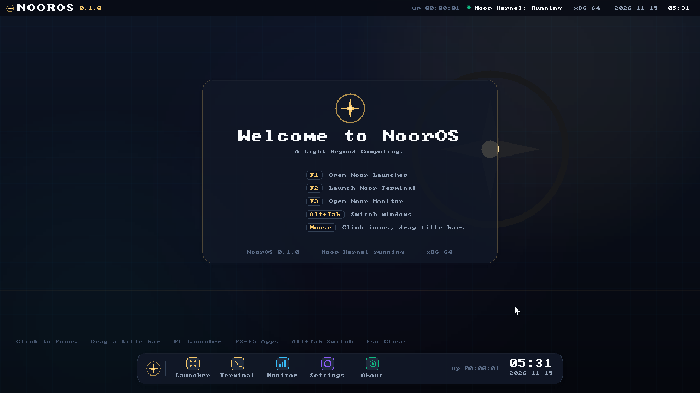
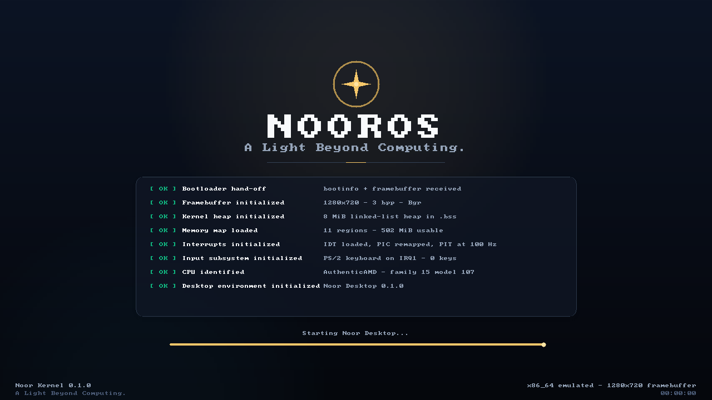
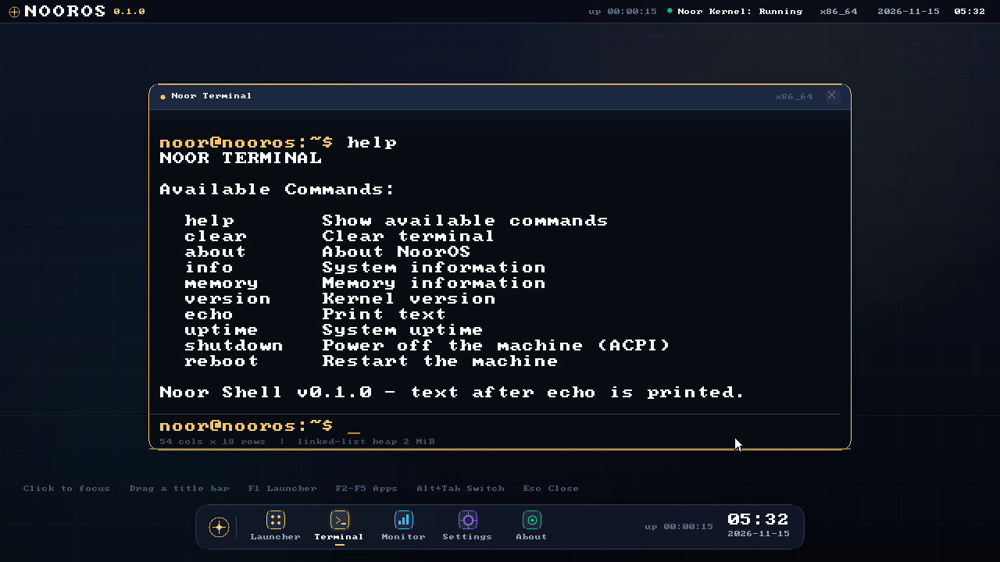
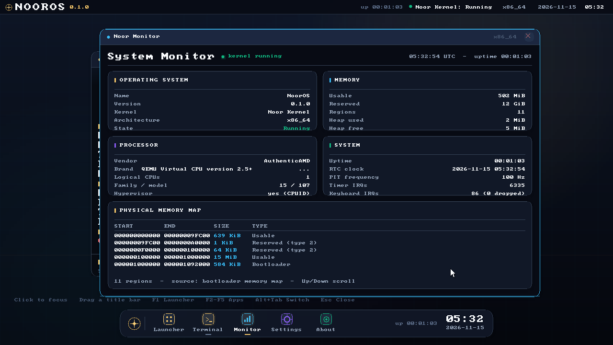
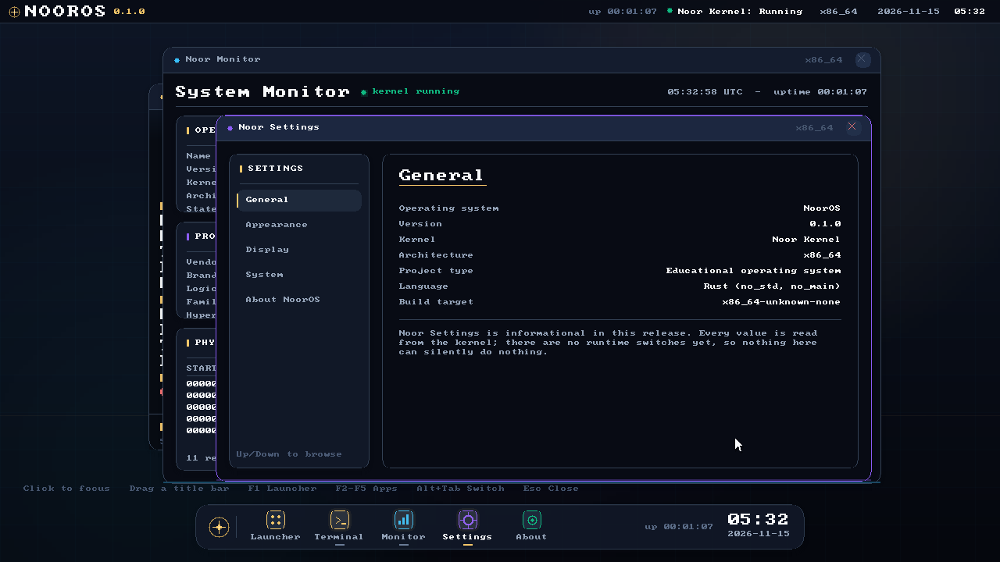
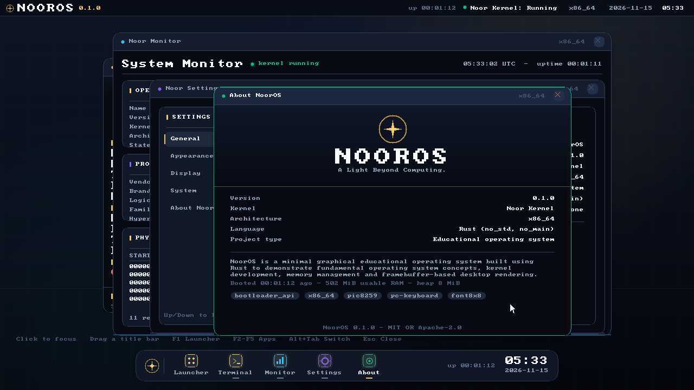
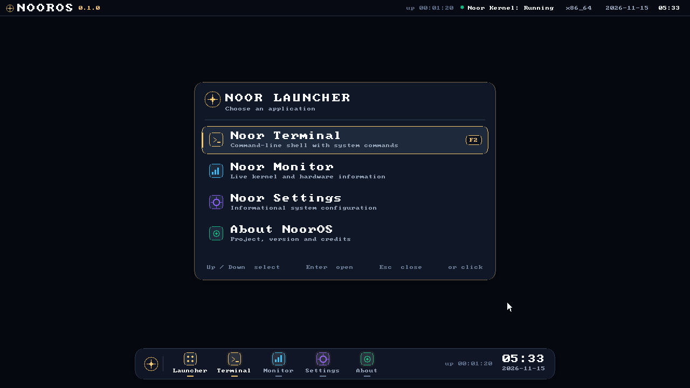
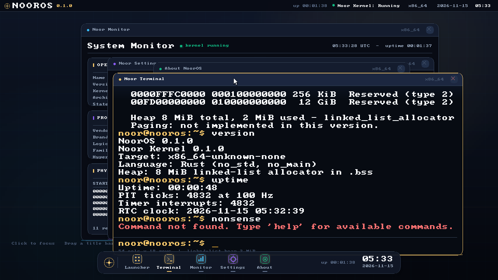
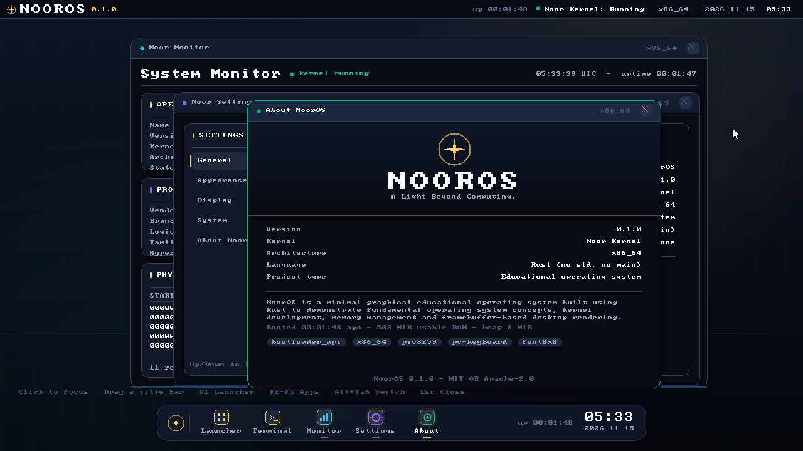
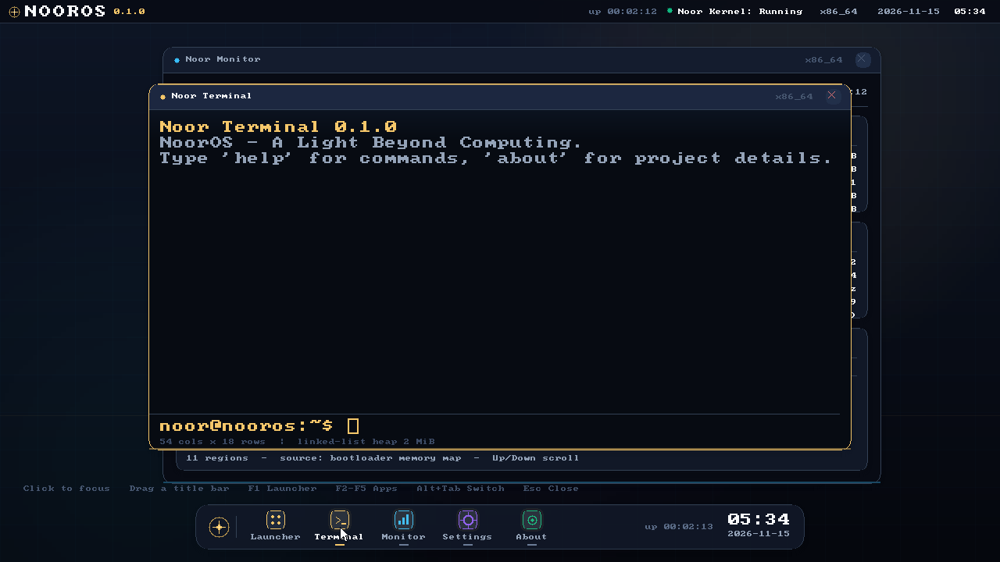

# NoorOS

> **A Light Beyond Computing.**

NoorOS is a small, real operating system for x86_64 written from scratch in Rust.
It boots on bare metal or in QEMU, takes over the framebuffer, draws every pixel of
its own graphical desktop, and runs a terminal, a system monitor, settings and a
launcher. There is no Linux underneath, no browser engine, no HTML, and no
simulation: the kernel is the program.



| | |
|---|---|
| **Kernel** | Noor Kernel 0.1.0 - `no_std`, `no_main`, x86_64 |
| **Desktop** | Noor Desktop - immediate-mode framebuffer renderer |
| **Applications** | Noor Terminal, Noor Monitor, Noor Settings, About NoorOS, Noor Launcher |
| **Boot** | BIOS and UEFI disk images built in `build.rs` |
| **Display** | 32-bit linear framebuffer; QEMU supplies 1280x720 here |
| **Input** | PS/2 keyboard (IRQ1) and PS/2 mouse (IRQ12) with a graphical pointer |
| **Project type** | Educational operating system |

---

## 1. What is implemented

- A real BIOS/UEFI hand-off through the `bootloader` crate 0.11.17, with a
  kernel stack of 128 KiB and a `BootInfo` framebuffer plus physical memory map.
- An IDT with CPU exception handlers, a remapped 8259 PIC, PIT channel 0 at
  100 Hz, PS/2 keyboard input on IRQ1 and PS/2 mouse input on IRQ12.
- A PS/2 mouse driver with a three-byte packet parser, a 12x19 alpha-blended
  arrow cursor drawn with save-under (so it leaves no trails), and window
  hit-testing: taskbar launch, launcher rows, click-to-focus, drag by title bar
  and a per-window `[X]` close button.
- A boot screen whose eight `[ OK ]` lines are printed only after each subsystem
  has actually initialised: framebuffer, heap, memory map, interrupts, input,
  CPUID, and the desktop.
- A physical-memory report classified from the bootloader map, and an 8 MiB
  static kernel heap in `.bss` backed by `linked_list_allocator` (so `String`,
  `Vec` and `format!` work in the kernel).
- A framebuffer graphics engine with 24/32-bit pixel-format handling, integer
  scaling, alpha blending, rounded panels, gradients and a `font8x8` bitmap font.
- A window manager with z-order, focus, a floating taskbar, a top status bar, a
  modal launcher and five applications.
- A shell with ten commands, scrollback, input history, line editing and
  honest output for unavailable features.

Everything above was verified by booting the release image in QEMU, not by
reading the source.

## 2. What is deliberately not implemented

NoorOS 0.1.0 is honest about its scope. It does **not** have:

- virtual memory, page tables of its own, or demand paging,
- user mode, processes, scheduling, or system calls,
- GPU acceleration, a compositor, window damage tracking, or double buffering of
  arbitrary windows,
- networking, storage drivers, a filesystem, sound, or SMP.

The kernel prints `Paging: not implemented in this version.` in `memory`, and
Noor Settings states that it is informational rather than a set of live switches.

## 3. Quick start (macOS on Apple Silicon)

```bash
# Prerequisites (once)
xcode-select --install
brew install qemu
curl --proto '=https' --tlsv1.2 -sSf https://sh.rustup.rs | sh
export PATH="$HOME/.cargo/bin:$PATH"
rustup toolchain install nightly \
  --component rust-src --component llvm-tools-preview \
  --component rustfmt --component clippy \
  --target x86_64-unknown-none --target x86_64-unknown-uefi
```

macOS ships a Homebrew `rustc`/`cargo` that can shadow rustup. Keep
`$HOME/.cargo/bin` first in `PATH` (or use `make`, which sets it for you).

```bash
# Build the kernel, both disk images, and the host launcher
cargo build --release

# Boot the BIOS image in a QEMU window
cargo run --release
# or
make run
```

Press `F2` for Noor Terminal, type `help`, then `shutdown` to power QEMU off.
The window opens at 1280x720 because that is the mode QEMU's `-vga std` supplies;
the image requests 1280x800 and the kernel uses whatever `BootInfo` reports.

First build takes a few minutes on an M-series Mac because the whole x86_64
guest runs under QEMU's TCG emulation. Later starts are much faster.

See [docs/setup-macos.md](docs/setup-macos.md) for the long version and
troubleshooting.

## 4. Controls

| Key | Action |
|---|---|
| `F1` | Open/close Noor Launcher |
| `F2` | Open Noor Terminal |
| `F3` | Open Noor Monitor |
| `F4` | Open Noor Settings |
| `F5` | Open About NoorOS |
| `Alt+Tab` / `Ctrl+Tab` | Cycle focus through open windows |
| `Up` / `Down` + `Enter` | Select and open in the launcher |
| `Esc` / `Ctrl+W` | Close the focused window |
| `PgUp` / `PgDn` | Scroll terminal output |
| `shutdown` / `reboot` | Power off / restart from the terminal |

Mouse:

| Action | Effect |
|---|---|
| Click a taskbar icon | Open (or focus) that application |
| Click the taskbar `Launcher` icon | Open the launcher; click any row to launch |
| Click a window | Focus it and raise it to the top of the z-order |
| Drag a title bar | Move the window; the title bar always stays reachable |
| Click the `[X]` button | Close that window |
| Move the pointer | Cursor-only repaint, so motion stays smooth under TCG |

## 5. Shell commands

| Command | Description |
|---|---|
| `help` | List available commands |
| `clear` | Clear the terminal |
| `about` | About NoorOS |
| `info` | Live system information |
| `memory` | Physical memory map and heap statistics |
| `version` | Kernel version and build target |
| `echo <text>` | Print text |
| `uptime` | PIT ticks, uptime and RTC clock |
| `shutdown` | ACPI power-off (QEMU exits) |
| `reboot` | Reset the machine through the 8042 controller |

An unknown command prints the required message:

```
Command not found. Type 'help' for available commands.
```

## 6. Screenshots

All images were captured from the running release image through QEMU's monitor
(`screendump`), not mocked up.

| Boot | Terminal | Monitor |
|---|---|---|
|  |  |  |

| Settings | About | Launcher |
|---|---|---|
|  |  |  |

| Drag a title bar | Close with [X] | Launch from the taskbar |
|---|---|---|
|  |  |  |

The full set, including `info`, `memory`, `version`, `uptime`, the unknown-command
error, Alt+Tab and the mouse sequence, is in [`screenshots/demo/`](screenshots/demo/).

## 7. Project layout

```
.
├── Cargo.toml            Host crate + workspace; artifact dependency on the kernel
├── build.rs              Builds nooros-bios.img and nooros-uefi.img
├── src/main.rs           Host launcher: locates images, starts QEMU, handles UEFI OVMF
├── kernel/
│   ├── Cargo.toml        Guest crate (x86_64-unknown-none)
│   └── src/
│       ├── main.rs       #![no_std] #![no_main] entry point
│       ├── kernel/       Init order, panic handler, fatal screen
│       ├── boot/         Boot screen with real init steps
│       ├── drivers/      Framebuffer, serial, keyboard, mouse, PIT, RTC, CPUID, power
│       ├── interrupts/   IDT, exceptions, PIC, IRQ0/IRQ1/IRQ12
│       ├── memory/       Bootloader memory map + 8 MiB heap
│       ├── graphics/     Canvas, primitives, text/fonts, branding
│       ├── desktop/      Window manager, taskbar, launcher, mouse cursor
│       ├── applications/ Terminal, Monitor, Settings, About, shared widgets
│       └── shell/        Parser and command implementations
├── scripts/              capture.py, interact.py, run.sh
├── docs/                 Setup, architecture, report, viva Q&A, demo guide
└── screenshots/demo/     Evidence captured from QEMU
```

## 8. Verification

```bash
cargo build --release          # kernel + BIOS image + UEFI image + launcher
cargo clippy --release         # warning-free
python3 scripts/interact.py screenshots/demo   # drive the GUI and capture shots
python3 scripts/capture.py /tmp/noor-boot --delay 2.5
```

The interactive demo script opens the terminal, runs `help`, `info`, `memory`,
`version`, `uptime`, an unknown command, then Monitor, Settings, About, Alt+Tab
and the Launcher. It then drives the mouse through QEMU's monitor: click a
launcher row, drag the terminal by its title bar, close it with `[X]`, raise
Noor Monitor by clicking its title bar, and launch the terminal from the
taskbar, taking a screenshot after each step.

Verified during development:

- BIOS boot and UEFI boot with OVMF both reach Noor Desktop.
- `shutdown` exits QEMU with status 0.
- `reboot` resets the guest and returns to a fresh desktop with uptime 1 s.
- The terminal reports 502 MiB usable RAM, 11 regions, and 100 Hz timer ticks.
- The mouse path was verified with QEMU monitor `mouse_move`/`mouse_button`:
  the cursor tracks 1:1 with injected motion, a leave-and-return move restores
  the framebuffer pixel for pixel (no trails), and every hit-test listed in
  section 4 was exercised by `scripts/interact.py`.

Serial logs from both firmware paths are committed as
[BIOS boot](docs/evidence/bios-boot.log) and
[UEFI boot](docs/evidence/uefi-boot.log).

## 9. Documentation

- [Build and run on macOS](docs/setup-macos.md)
- [Architecture](docs/architecture.md)
- [University project report](docs/university-report.md)
- [20 viva questions and answers](docs/viva-questions.md)
- [Demo guide](docs/demo-guide.md)
- [Roadmap: USB boot, real hardware, installer](docs/roadmap.md)

The report header still contains `<your name>`, `<Operating Systems / Systems
Programming>`, `<your university>` and `<supervisor>` placeholders; fill those in
before submitting.

## 10. Licence

NoorOS is dual-licensed under MIT OR Apache-2.0. See
[LICENSE-MIT](LICENSE-MIT) and [LICENSE-APACHE](LICENSE-APACHE).
